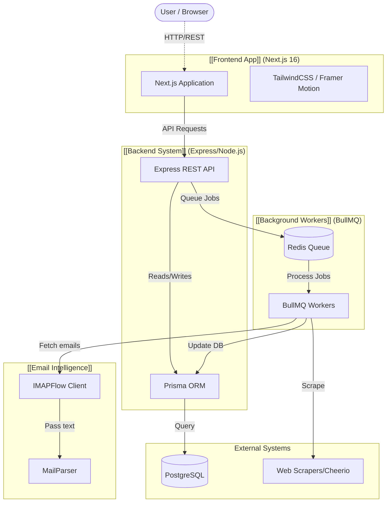

---
tags:
  - architecture
  - project-graph
  - overview
---

# 🌐 GeoLead AI - Project Architecture Graph

Welcome to the Obsidian map of the project. Obsidian will use the `[[Wikilinks]]` below to generate a natural network graph of the system. You can optionally create these files to build out your vault further.

## 📊 Visual Graph (Mermaid)

## 🗺️ Map of Content (MOC) - Subsystem Nodes

*To populate your Obsidian graph view, simply click any of the links below to create the stub note in your vault.*

### 🖥️ [[Frontend App]]
- **Framework**: Next.js 16 (React 19)
- **Styling**: Tailwind CSS v4 + Framer Motion
- **Icons**: Lucide React
- **Location**: `./frontend/` and UI definitions in `./Design Front End UI_UX/`

### ⚙️ [[Backend System]]
- **Framework**: Express.js with TypeScript
- **Auth**: bcryptjs + jsonwebtoken
- **Location**: `./backend/`
- **Sub-components**: 
  - [[REST API Routes]] (Auth, Domains, Inbox, Outbound)
  - [[Middleware]] (Auth, Rate Limiting)

### 🗄️ [[Database & Models]]
- **ORM**: Prisma 5.10
- **Location**: `./backend/prisma/`
- Data Models include Accounts, Email Tracking, Domain Reputation, Watchlists.

### 🔄 [[Background Workers]]
- **Queueing Engine**: BullMQ + Redis
- **Usage**: Processing heavy background tasks (crawling, validation, heavy DB queries, email polling).
- **Location**: `./backend/src/queues/` and `./backend/src/workers/`

### 📧 [[Email Intelligence]]
- **Engine**: IMAPFlow + MailParser
- **Purpose**: Polling mailbox for auto-replies, bounced emails, or prospective replies.

### 🌐 [[Web Scraping]]
- **Tools**: Cheerio, Axios
- **Purpose**: Collecting domain intelligence, verifying leads.

## 🛠️ Infrastructure 
- Monorepo runner via `concurrently` (Workspace Root)
- [[Docker Services]] for database and redis (`docker-compose.yml`)
- Cloud Deployment docs references: [[DEPLOYMENT.md]]

